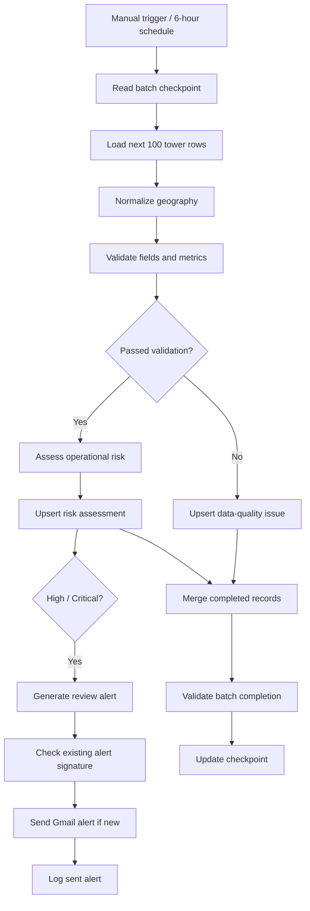

# Agentic AI–Powered Telecom Network Monitoring

**n8n workflow for telecom data-quality validation, historical/predictive network-risk triage, automated review alerts, and resumable batch processing.**

> **Portfolio / demonstration workflow.** The supplied design uses configured JavaScript rules and *pre-existing* predicted-risk probabilities from a tower watchlist. It does not train or invoke a machine-learning model or LLM within n8n, and it does **not** independently verify live outages. Geographic reference mappings are illustrative and should not be treated as authoritative production geocoding.

## Business problem

Telecom operations teams need a repeatable way to identify unreliable or high-risk tower sites, flag inconsistent records, prioritize engineering review, and avoid processing the same source rows repeatedly.

The system addresses these needs by reading telecom tower observations from an n8n Data Table, validating and normalizing records, classifying operational risk, persisting results, and sending review alerts for qualifying sites.

## Workflow overview

The alert-delivery branch and the checkpoint branch are separate; the checkpoint calculation verifies the processed records from the two persistence paths, **not** successful alert delivery.

## Features

- **Data validation:** Required fields, numeric ranges, integer constraints, duplicate tower IDs within a batch, and a limited city/state reference check.
- **Geographic normalization:** Maps known synthetic city names to expected Nigerian states, retaining the original state and marking corrections as assumed.
- **Risk triage:** Combines uptime, historical outage count, downtime, and an upstream `predicted_risk_probability` value to label **CRITICAL**, **HIGH**, **MEDIUM**, **LOW**, or **INSUFFICIENT_DATA**.
- **Prioritization:** Gives action recommendations such as urgent engineer review or preventive inspection.
- **Alerting:** Formats a review report, checks for a previously delivered matching alert signature, sends a `[TEST]` Gmail message, and records the Gmail message ID.
- **Incremental processing:** Reads up to 100 rows in ascending `id` order using a saved `last_processed_id` checkpoint. The workflow currently has a six-hour schedule plus a manual trigger.

## Technology

**n8n**, JavaScript Code nodes, n8n Data Tables, n8n Schedule Trigger, n8n Merge / IF nodes, **Gmail OAuth2**. Input risk-probability values come from an existing dataset/model output; no model inference node is present in this export.

## n8n data tables

Create or select these tables in your own workspace and map them to the corresponding nodes after importing the template:

| Table name | Purpose |
| --- | --- |
| `telecom_tower_risk_watchlist` | Source tower records and precomputed predicted risk scores |
| `telecom_batch_progress` | Stores `batch_key` and `last_processed_id` |
| `telecom_data_quality_issues` | Records validation failures and diagnostic information |
| `telecom_network_risk_assessments` | Persists risk level, signals, and recommended action |
| `telecom_alert_delivery_log` | Records alert signatures and sent-message metadata |

The exported source workflow uses a batch key of `TELECOM_NETWORK`. Populate `telecom_batch_progress` with a matching entry (for a fresh import, `last_processed_id = 0`) and load representative watchlist records before testing. Consult the node mappings for the full field schemas.

## Import and configuration

1. Download `telecom_ai_workflow_public_template.json` from this repository.
2. Import the JSON into a new workflow in **n8n**; do not replace a working production workflow.
3. Open every Data Table node and select the five matching tables from **your** workspace. The template intentionally removes original workspace table IDs.
4. Open the Gmail node, add your own **Gmail OAuth2 credentials**, and replace `YOUR_ALERT_EMAIL@example.com` with an authorized recipient.
5. Confirm your n8n workflow timezone (the original configuration uses `Africa/Lagos`) and check the six-hour schedule.
6. Validate the source schema and insert a test batch. Confirm both successful and failed validation paths, output records, alerts, and checkpoint updates.
7. Keep the workflow inactive until verification is complete; then activate/publish only when ready. Do not send test alerts to unintended recipients.

> **Security:** This is a public **template**, not a ready-to-run export of the private workspace. Credential connections, recipient email address, private workspace IDs, and individual table resource IDs have been removed. You must rebind the nodes after import.

## Input data (selected fields)

`tower_id`, `operator`, `state`, `city`, `network_type`, `latest_uptime`, `historical_total_downtime_minutes`, `historical_total_outage_count`, `site_reliability_risk_score`, `risk_category_final`, `predicted_risk_probability`, `predicted_risk_category`, `recommended_priority`, `data_origin`, and numeric table `id`.

## Risk interpretation

The risk logic is configured inside **Assess Telecom Network Risk**:

| Risk | Example rule (any qualifying condition, where applicable) | Recommended action |
| --- | --- | --- |
| CRITICAL | Uptime below 90%, or probability ≥ 0.80 together with ≥ 20 historic outages | Urgent engineer review |
| HIGH | Uptime below 97%, probability ≥ 0.60, ≥ 20 historic outages, or ≥ 500 minutes downtime (unless already critical) | Priority network inspection |
| MEDIUM | Uptime below 99%, probability ≥ 0.40, ≥ 10 historic outages, or ≥ 240 minutes downtime (unless higher category) | Schedule preventive inspection |
| LOW | None of the configured thresholds triggered | Routine monitoring |

Thresholds are configurable heuristics, **not** independently calibrated probabilities of a current live outage. Invalid records are excluded from this risk path and logged for data-quality review.

## Scope and limitations

- **No live network telemetry** is connected in the exported workflow. `active_outage_status` is explicitly `NOT_VERIFIED`.
- **No LLM agent, dynamic planning, RAG system, or in-workflow predictive model** appears in this JSON. The automation applies deterministic rules to a pre-existing risk-probability field.
- Geography checks cover a **small, synthetic reference map**; unrecognized cities may be flagged even if they are legitimate. Automatic corrections are assumed from the city, not verified against an authoritative gazetteer.
- The review alert uses an exact signature over the selected risk fields to suppress repeated identical alerts; this is not the same as time-based alert throttling.
- Current alert messages retain the `[TEST]` prefix until an operator changes it.
- The completion checkpoint validates source/output row counts and tower IDs, but does not wait for confirmation of successful Gmail delivery. Mixed, all-valid, all-invalid, empty and failed-action scenarios should all be acceptance-tested before operational use.
- A batch size of 100 is configured; the total size of the dataset is not proven by the export alone.

## Documentation

See [`TECHNICAL_DOCUMENTATION.md`](TECHNICAL_DOCUMENTATION.md) for architecture, rule thresholds, test cases, and deployment considerations. See [`SECURITY_REVIEW.md`](SECURITY_REVIEW.md) for the sanitization report.

## Portfolio disclaimer

This repository documents a portfolio automation workflow and does not represent verified production deployment, telecom operator endorsement, or guaranteed improvements to downtime or service availability.
